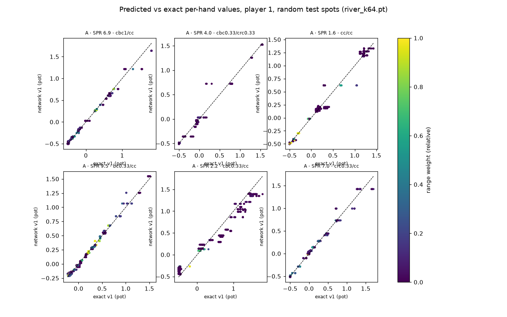
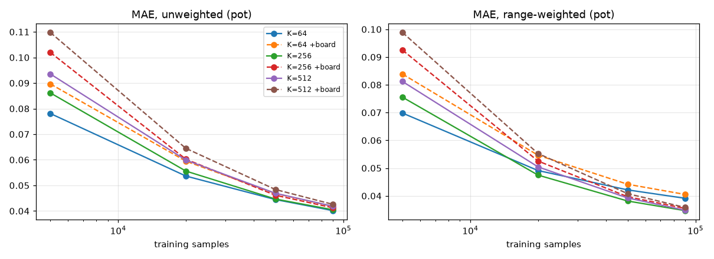

# River value network PoC: results

Model `river_net/models/river_k64.pt` (K = 64), evaluated on 5,009 test spots whose boards never appear in training (split by board). All errors are in **pot units** (fractions of the starting river pot), per hand, against the exact solver's conditional values `v_i(h)`; both players pooled.

* **network**: model bucket values broadcast to hands.
* **floor**: the bucketing floor, a perfect network at K = 64.
* **check-down**: showdown equity vs the compatible opponent range − ½ (ignores river betting).
* `mae`: mean over valid hands; `wmae`: weighted by the player's range; root: `|Σ r m (v̂ − v)|`; zero-sum resid.: `|Σ w1 ŷ1 + Σ w2 ŷ2|` before projection.

## Overall

| | network | floor | check-down |
|---|---|---|---|
| MAE (unweighted) | 0.0350 | 0.0126 | 0.1564 |
| MAE (range-weighted) | 0.0352 | 0.0208 | 0.1288 |
| root value error, player 1 | 0.0074 | 0.0048 | 0.0500 |
| root value error, player 2 | 0.0074 | 0.0052 | 0.0500 |
| zero-sum residual before projection | 0.2113 | | |

The raw (pre-projection) residual is not a training target: the projection subtracts a constant from all outputs, so the network is free to leave any offset in its raw outputs, and only projected values are ever used.

Network / floor: **2.78×** (unweighted), **1.69×** (range-weighted). Network beats check-down on every breakdown below: **yes**.

## By source

| group | n | network mae | network wmae | floor mae | floor wmae | check-down mae | check-down wmae |
|---|---|---|---|---|---|---|---|
| A | 3492 | 0.0348 | 0.0350 | 0.0124 | 0.0211 | 0.1610 | 0.1264 |
| B | 1011 | 0.0411 | 0.0406 | 0.0129 | 0.0215 | 0.1587 | 0.1419 |
| C | 506 | 0.0243 | 0.0253 | 0.0136 | 0.0176 | 0.1204 | 0.1198 |

## By pot type

| group | n | network mae | network wmae | floor mae | floor wmae | check-down mae | check-down wmae |
|---|---|---|---|---|---|---|---|
| 3bet | 799 | 0.0420 | 0.0424 | 0.0133 | 0.0260 | 0.1599 | 0.1288 |
| 4bet | 160 | 0.0473 | 0.0473 | 0.0118 | 0.0289 | 0.1458 | 0.1117 |
| srp | 4050 | 0.0332 | 0.0333 | 0.0125 | 0.0195 | 0.1561 | 0.1295 |

## By river line (flop/turn)

| group | n | network mae | network wmae | floor mae | floor wmae | check-down mae | check-down wmae |
|---|---|---|---|---|---|---|---|
| bc/bc | 344 | 0.0360 | 0.0421 | 0.0133 | 0.0271 | 0.1389 | 0.1480 |
| bc/brc | 119 | 0.0370 | 0.0461 | 0.0123 | 0.0317 | 0.1330 | 0.1305 |
| bc/cbc | 260 | 0.0351 | 0.0347 | 0.0124 | 0.0202 | 0.1566 | 0.1350 |
| bc/cc | 423 | 0.0380 | 0.0358 | 0.0137 | 0.0219 | 0.1534 | 0.1331 |
| bc/crc | 135 | 0.0336 | 0.0405 | 0.0124 | 0.0261 | 0.1549 | 0.1277 |
| brc/bc | 112 | 0.0409 | 0.0480 | 0.0130 | 0.0314 | 0.1419 | 0.1478 |
| brc/brc | 33 | 0.0423 | 0.0500 | 0.0115 | 0.0319 | 0.1079 | 0.1027 |
| brc/cbc | 101 | 0.0403 | 0.0448 | 0.0119 | 0.0250 | 0.1504 | 0.1496 |
| brc/cc | 195 | 0.0363 | 0.0387 | 0.0133 | 0.0242 | 0.1309 | 0.1266 |
| brc/crc | 47 | 0.0323 | 0.0434 | 0.0110 | 0.0313 | 0.1386 | 0.1020 |
| cbc/bc | 263 | 0.0330 | 0.0369 | 0.0133 | 0.0227 | 0.1513 | 0.1264 |
| cbc/brc | 94 | 0.0384 | 0.0435 | 0.0120 | 0.0232 | 0.1429 | 0.1517 |
| cbc/cbc | 210 | 0.0336 | 0.0285 | 0.0119 | 0.0142 | 0.1902 | 0.1313 |
| cbc/cc | 372 | 0.0366 | 0.0311 | 0.0129 | 0.0166 | 0.1740 | 0.1327 |
| cbc/crc | 115 | 0.0258 | 0.0287 | 0.0114 | 0.0171 | 0.1820 | 0.0965 |
| cc/bc | 402 | 0.0326 | 0.0318 | 0.0131 | 0.0192 | 0.1512 | 0.1370 |
| cc/brc | 147 | 0.0352 | 0.0386 | 0.0131 | 0.0236 | 0.1265 | 0.1296 |
| cc/cbc | 306 | 0.0377 | 0.0311 | 0.0128 | 0.0159 | 0.1685 | 0.1315 |
| cc/cc | 349 | 0.0411 | 0.0327 | 0.0134 | 0.0176 | 0.1783 | 0.1278 |
| cc/crc | 220 | 0.0308 | 0.0306 | 0.0116 | 0.0175 | 0.1605 | 0.1148 |
| crc/bc | 176 | 0.0316 | 0.0361 | 0.0114 | 0.0222 | 0.1388 | 0.1272 |
| crc/brc | 45 | 0.0374 | 0.0455 | 0.0109 | 0.0277 | 0.1316 | 0.1178 |
| crc/cbc | 145 | 0.0290 | 0.0276 | 0.0099 | 0.0144 | 0.1815 | 0.1069 |
| crc/cc | 327 | 0.0305 | 0.0306 | 0.0125 | 0.0188 | 0.1587 | 0.1120 |
| crc/crc | 69 | 0.0296 | 0.0329 | 0.0098 | 0.0190 | 0.1557 | 0.0895 |

## By SPR

| group | n | network mae | network wmae | floor mae | floor wmae | check-down mae | check-down wmae |
|---|---|---|---|---|---|---|---|
| 1-3 | 1563 | 0.0354 | 0.0382 | 0.0127 | 0.0229 | 0.1601 | 0.1369 |
| 3-8 | 1713 | 0.0347 | 0.0333 | 0.0135 | 0.0198 | 0.1606 | 0.1329 |
| <1 | 937 | 0.0358 | 0.0395 | 0.0107 | 0.0240 | 0.1383 | 0.1094 |
| >8 | 796 | 0.0341 | 0.0281 | 0.0127 | 0.0153 | 0.1617 | 0.1272 |

## By preflop scenario

| group | n | network mae | network wmae | floor mae | floor wmae | check-down mae | check-down wmae |
|---|---|---|---|---|---|---|---|
| BTN raise 2.5bb, BB call | 909 | 0.0308 | 0.0307 | 0.0121 | 0.0181 | 0.1519 | 0.1282 |
| BTN raise 2.5bb, BB raise 14bb, BTN call | 50 | 0.0378 | 0.0375 | 0.0110 | 0.0204 | 0.1524 | 0.1376 |
| BTN raise 2.5bb, BB raise 14bb, BTN raise 29.5bb, BB call | 1 | 0.0926 | 0.0514 | 0.0117 | 0.0091 | 0.3306 | 0.0848 |
| BTN raise 2.5bb, SB raise 11.5bb, BTN call | 78 | 0.0400 | 0.0412 | 0.0133 | 0.0244 | 0.1481 | 0.1360 |
| BTN raise 2.5bb, SB raise 11.5bb, BTN raise 24bb, SB call | 12 | 0.0381 | 0.0326 | 0.0101 | 0.0163 | 0.1508 | 0.0927 |
| CO raise 2.5bb, BB call | 641 | 0.0314 | 0.0330 | 0.0124 | 0.0204 | 0.1588 | 0.1265 |
| CO raise 2.5bb, BB raise 14bb, CO call | 27 | 0.0365 | 0.0474 | 0.0135 | 0.0326 | 0.1300 | 0.1164 |
| CO raise 2.5bb, BB raise 14bb, CO raise 29.5bb, BB call | 1 | 0.0390 | 0.0411 | 0.0113 | 0.0202 | 0.2349 | 0.1853 |
| CO raise 2.5bb, BTN call | 154 | 0.0418 | 0.0421 | 0.0154 | 0.0266 | 0.1679 | 0.1316 |
| CO raise 2.5bb, BTN raise 7.5bb, CO call | 107 | 0.0445 | 0.0434 | 0.0140 | 0.0256 | 0.1770 | 0.1381 |
| CO raise 2.5bb, BTN raise 7.5bb, CO raise 20bb, BTN call | 20 | 0.0539 | 0.0549 | 0.0120 | 0.0367 | 0.1374 | 0.1017 |
| CO raise 2.5bb, SB raise 11.5bb, CO call | 48 | 0.0480 | 0.0502 | 0.0136 | 0.0302 | 0.1492 | 0.1303 |
| CO raise 2.5bb, SB raise 11.5bb, CO raise 24bb, SB call | 17 | 0.0406 | 0.0419 | 0.0103 | 0.0272 | 0.1533 | 0.1043 |
| HJ raise 2bb, BB call | 607 | 0.0332 | 0.0333 | 0.0123 | 0.0190 | 0.1610 | 0.1285 |
| HJ raise 2bb, BB raise 11bb, HJ call | 16 | 0.0440 | 0.0447 | 0.0147 | 0.0310 | 0.1347 | 0.1075 |
| HJ raise 2bb, BB raise 11bb, HJ raise 23bb, BB call | 3 | 0.1466 | 0.0872 | 0.0119 | 0.0157 | 0.2146 | 0.1896 |
| HJ raise 2bb, BTN call | 108 | 0.0488 | 0.0482 | 0.0165 | 0.0313 | 0.1590 | 0.1406 |
| HJ raise 2bb, BTN raise 6bb, HJ call | 50 | 0.0434 | 0.0431 | 0.0140 | 0.0260 | 0.1563 | 0.1258 |
| HJ raise 2bb, BTN raise 6bb, HJ raise 16bb, BTN call | 31 | 0.0450 | 0.0477 | 0.0117 | 0.0290 | 0.1511 | 0.1235 |
| HJ raise 2bb, CO raise 6bb, HJ call | 59 | 0.0460 | 0.0465 | 0.0137 | 0.0286 | 0.1807 | 0.1288 |
| HJ raise 2bb, CO raise 6bb, HJ raise 16bb, CO call | 16 | 0.0514 | 0.0507 | 0.0132 | 0.0363 | 0.1477 | 0.1274 |
| HJ raise 2bb, SB raise 9bb, HJ call | 21 | 0.0485 | 0.0542 | 0.0165 | 0.0384 | 0.1357 | 0.1376 |
| HJ raise 2bb, SB raise 9bb, HJ raise 19bb, SB call | 19 | 0.0319 | 0.0419 | 0.0122 | 0.0298 | 0.1249 | 0.0959 |
| SB raise 3bb, BB call | 897 | 0.0324 | 0.0311 | 0.0116 | 0.0157 | 0.1481 | 0.1352 |
| SB raise 3bb, BB raise 9bb, SB call | 144 | 0.0329 | 0.0311 | 0.0108 | 0.0170 | 0.1465 | 0.1171 |
| SB raise 3bb, BB raise 9bb, SB raise 24bb, BB call | 15 | 0.0528 | 0.0421 | 0.0090 | 0.0189 | 0.1177 | 0.0896 |
| UTG raise 2bb, BB call | 625 | 0.0327 | 0.0330 | 0.0126 | 0.0207 | 0.1621 | 0.1231 |
| UTG raise 2bb, BB raise 11bb, UTG call | 19 | 0.0500 | 0.0446 | 0.0166 | 0.0306 | 0.1655 | 0.1154 |
| UTG raise 2bb, BB raise 11bb, UTG raise 23bb, BB call | 1 | 0.0332 | 0.0398 | 0.0094 | 0.0164 | 0.0984 | 0.0901 |
| UTG raise 2bb, BTN call | 109 | 0.0447 | 0.0480 | 0.0162 | 0.0325 | 0.1615 | 0.1408 |
| UTG raise 2bb, BTN raise 6bb, UTG call | 65 | 0.0410 | 0.0401 | 0.0140 | 0.0270 | 0.1731 | 0.1216 |
| UTG raise 2bb, BTN raise 6bb, UTG raise 16bb, BTN call | 8 | 0.0494 | 0.0526 | 0.0130 | 0.0300 | 0.1467 | 0.1388 |
| UTG raise 2bb, CO raise 6bb, UTG call | 43 | 0.0435 | 0.0400 | 0.0131 | 0.0257 | 0.1776 | 0.1275 |
| UTG raise 2bb, CO raise 6bb, UTG raise 16bb, CO call | 7 | 0.0450 | 0.0555 | 0.0148 | 0.0354 | 0.1667 | 0.1412 |
| UTG raise 2bb, HJ raise 6bb, UTG call | 58 | 0.0504 | 0.0546 | 0.0154 | 0.0362 | 0.1697 | 0.1451 |
| UTG raise 2bb, HJ raise 6bb, UTG raise 16bb, HJ call | 4 | 0.0469 | 0.0584 | 0.0154 | 0.0457 | 0.1474 | 0.0940 |
| UTG raise 2bb, SB raise 9bb, UTG call | 14 | 0.0533 | 0.0612 | 0.0125 | 0.0335 | 0.1829 | 0.1380 |
| UTG raise 2bb, SB raise 9bb, UTG raise 19bb, SB call | 5 | 0.0461 | 0.0420 | 0.0137 | 0.0277 | 0.1494 | 0.1016 |

## Inference speed (CPU, 1 thread)

| batch | forward ms | spots/s (forward) | full predict ms/spot (bucketing + masses + forward) |
|---|---|---|---|
| 1 | 0.037 | 26,969 | 0.49 |
| 64 | 0.237 | 270,602 | 0.25 |
| 1024 | 2.561 | 399,821 | 0.24 |

## Predicted vs exact

## Learning curves and ablations

Test MAE (pot units) vs training-set size; each K with and without the 52-card board one-hot. `floor` is the bucketing floor at that K. Kept cheap: 3x256 MLPs, at most 25 epochs each (the shipped model trains longer).

| K | board | n train | MAE | wMAE | floor MAE | floor wMAE | epochs |
|---|---|---|---|---|---|---|---|
| 64 | no | 5,000 | 0.0781 | 0.0698 | 0.0126 | 0.0208 | 25 |
| 64 | no | 20,000 | 0.0537 | 0.0491 | 0.0126 | 0.0208 | 25 |
| 64 | no | 50,000 | 0.0445 | 0.0422 | 0.0126 | 0.0208 | 25 |
| 64 | no | 89,988 | 0.0401 | 0.0391 | 0.0126 | 0.0208 | 25 |
| 64 | yes | 5,000 | 0.0897 | 0.0839 | 0.0126 | 0.0208 | 25 |
| 64 | yes | 20,000 | 0.0595 | 0.0546 | 0.0126 | 0.0208 | 25 |
| 64 | yes | 50,000 | 0.0468 | 0.0442 | 0.0126 | 0.0208 | 25 |
| 64 | yes | 89,988 | 0.0418 | 0.0405 | 0.0126 | 0.0208 | 25 |
| 256 | no | 5,000 | 0.0862 | 0.0755 | 0.0085 | 0.0098 | 25 |
| 256 | no | 20,000 | 0.0556 | 0.0475 | 0.0085 | 0.0098 | 25 |
| 256 | no | 50,000 | 0.0447 | 0.0381 | 0.0085 | 0.0098 | 25 |
| 256 | no | 89,988 | 0.0405 | 0.0347 | 0.0085 | 0.0098 | 25 |
| 256 | yes | 5,000 | 0.1020 | 0.0925 | 0.0085 | 0.0098 | 25 |
| 256 | yes | 20,000 | 0.0602 | 0.0525 | 0.0085 | 0.0098 | 25 |
| 256 | yes | 50,000 | 0.0462 | 0.0397 | 0.0085 | 0.0098 | 25 |
| 256 | yes | 89,988 | 0.0413 | 0.0355 | 0.0085 | 0.0098 | 25 |
| 512 | no | 5,000 | 0.0935 | 0.0812 | 0.0082 | 0.0087 | 25 |
| 512 | no | 20,000 | 0.0599 | 0.0504 | 0.0082 | 0.0087 | 25 |
| 512 | no | 50,000 | 0.0469 | 0.0392 | 0.0082 | 0.0087 | 25 |
| 512 | no | 89,988 | 0.0419 | 0.0348 | 0.0082 | 0.0087 | 25 |
| 512 | yes | 5,000 | 0.1098 | 0.0989 | 0.0082 | 0.0087 | 25 |
| 512 | yes | 20,000 | 0.0645 | 0.0553 | 0.0082 | 0.0087 | 25 |
| 512 | yes | 50,000 | 0.0484 | 0.0408 | 0.0082 | 0.0087 | 25 |
| 512 | yes | 89,988 | 0.0426 | 0.0358 | 0.0082 | 0.0087 | 25 |

